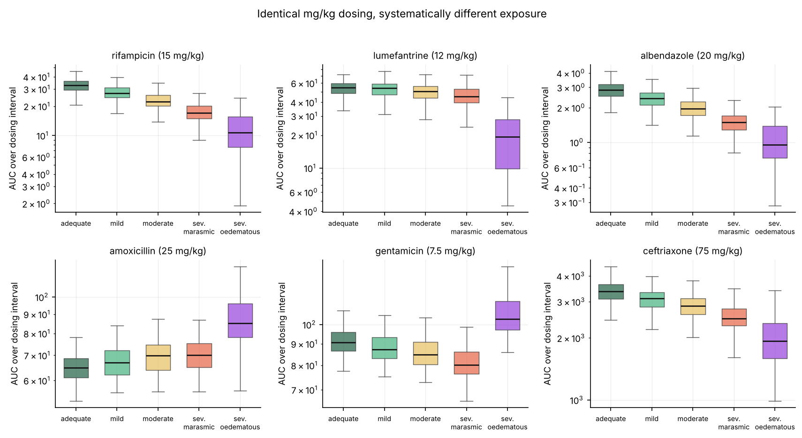
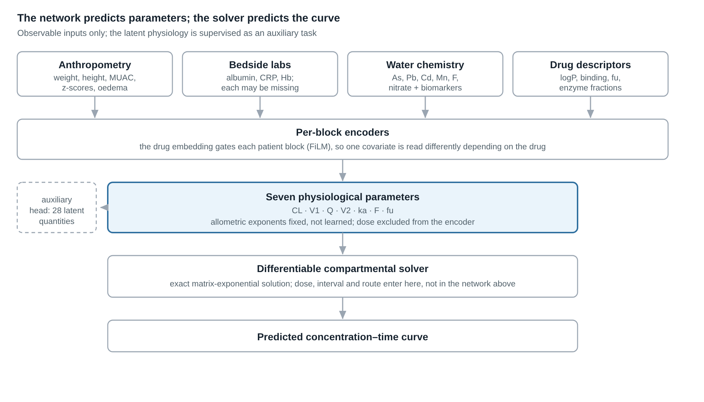
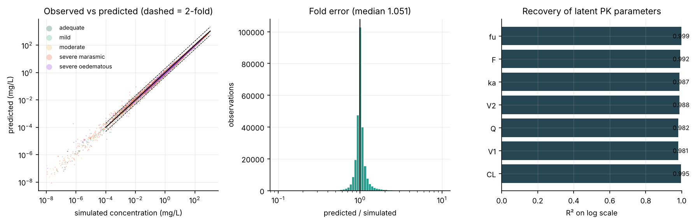
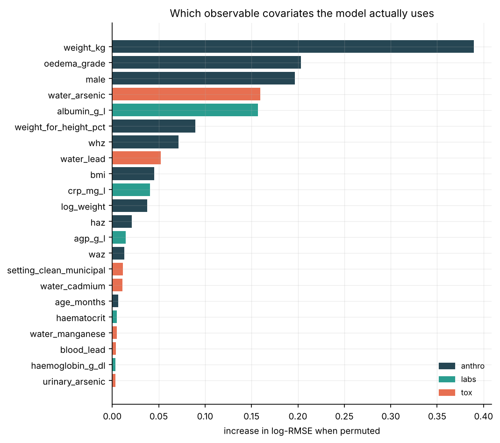
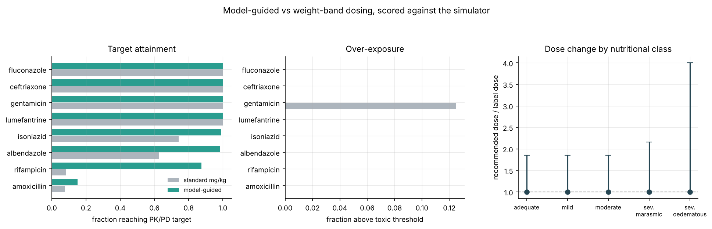

# Mechanism-constrained deep learning recovers individual pharmacokinetics under undernutrition and water-toxicant co-exposure

**An in silico study**

Pranav Manne1

1 Independent researcher

Correspondence: pranavmanne17@gmail.com · ORCID: 0009-0004-7575-7208

**Keywords:** pharmacokinetics; severe acute malnutrition; physiologically based
modelling; scientific machine learning; dose individualisation; environmental
toxicants; paediatric pharmacology; uncertainty calibration

### Declarations

**Funding.** This research received no specific grant from any funding agency
in the public, commercial or not-for-profit sectors.

**Competing interests.** The author declares no competing interests.

**Ethics approval.** Not applicable. No human participants, animals, biological
samples or identifiable data were involved, so no ethical approval was sought
or required.

**Consent.** Not applicable.

**Data and code availability.** All code, trained weights for all nine training
runs, and the evaluation outputs reproducing every number in this manuscript
are openly available at [REPOSITORY URL / DOI]. No empirical dataset exists or
is required: the synthetic dataset regenerates deterministically from a fixed
seed in under one minute, and the complete pipeline reproduces every figure and
table in approximately 2.5 hours on two CPU cores. The diagnostic reported in
"Sex: the model attributes more than the mechanism contains" is reproduced by
`scripts/diagnose_sex.py`.

**Author contributions.** Pranav Manne conceived the study, wrote the
simulator, model and analysis code, performed all experiments, and wrote the
manuscript.

**Supporting information.** Supplementary figures S1–S2, the full
pharmacodynamic target audit, per-drug and per-stratum dosing tables, and the
threshold sensitivity analyses are provided in the accompanying Supporting
Information.

## Abstract

We show that a neural network constrained by compartmental pharmacokinetic
structure can recover individual drug disposition from the sparse, noisy,
partially missing measurements obtainable in a low-resource setting — in a
simulated population whose generative process we specified.

Children with severe acute malnutrition are dosed in milligrams per kilogram,
a rule that treats every kilogram of body mass as pharmacokinetically
equivalent. Undernutrition violates that assumption along at least six axes
simultaneously, and in opposite directions for different drugs: body
composition shifts toward water, visceral organs are spared relative to body
weight, inflammation suppresses cytochrome P450 3A4, hypoalbuminaemia raises
the unbound fraction of acidic drugs while a rising acute-phase α1-acid
glycoprotein lowers it for basic drugs, enteropathy blunts absorption, and
cardiac output falls. These children are also largely absent from the trials
that set the labels, so the evidence needed to correct the dose does not
exist. They are, in addition, disproportionately exposed to contaminated
drinking water — an exposure that is not independent of their nutritional
state but mechanistically coupled to it.

We constructed a generative simulator in which nutritional status and
drinking-water toxicant exposure jointly determine body composition, organ
mass, enzyme capacity, protein binding and gut integrity, and from these
derive the pharmacokinetic parameters of nine essential medicines. We then
trained a model on 36,000 simulated concentration–time records from 12,000
virtual patients. The model receives only observable covariates; it predicts
seven physiological parameters, and a differentiable compartmental solver
converts them to a concentration–time curve. Allometric exponents are fixed
rather than learned, so any body-size effect the network acquires is by
construction a departure from the allometric rule. Dose is excluded from the
parameter encoder, making predictions exactly dose-proportional.

Against noise-free simulated truth, the model achieved a median fold error of
1.050 (98.6% of predictions within twofold; R² on the log scale 0.997) and
recovered the latent pharmacokinetic parameters, never supplied as inputs, 
with R² between 0.981 and 0.999. In a matched comparison holding inputs,
supervision and parameter count constant, replacing the mechanistic solver
with a direct curve-regression head cost 1.54-fold in log-RMSE. Auxiliary
supervision on parameters and latent physiology was worth considerably more
than the solver: 3.72-fold. Ablation identified drinking-water chemistry as
the dominant observable block: removing it degraded accuracy 2.05-fold,
against 1.34-fold for removal of the entire bedside biochemistry panel.

Two negative results bound the method. The model did not transfer to a drug
held out entirely (median fold error 11.2, 17.8% within twofold), and the
failure localises to the held-out drug with no chemical analogue in the
training set. Monte Carlo dropout was substantially overconfident, its nominal
90% interval covering 45.0% of the truth; uncorrected, this propagated into
systematically poor dose decisions.

Comparing the simulator with published pharmacokinetic measurements in
malnourished patients exposed two structural defects that the unit-test suite
had not caught — an organ-sparing mechanism that was silently inert, and
toxicant potencies set on an uninterpretable scale that implied
guideline-compliant drinking water would cost a child a third of their
glomerular filtration rate. After correction, predicted gentamicin clearance
and distribution volume in severe malnutrition fall within published ranges,
and a refitted absorption model reproduces published day-7 lumefantrine
concentrations in both malnourished and well-nourished arms. One disagreement
survives recalibration: the simulator predicts a halving of rifampicin
exposure that two published studies do not support, and the discrepancy
localises to plasma-protein binding.

These results establish that a mechanism-constrained architecture can invert a
known, complex generative process from realistically degraded observations.
They are not evidence about human pharmacokinetics. Calibrating the simulator
against real sparse pharmacokinetic data from undernourished cohorts, and
prospective validation, would both be required before any clinical
interpretation is warranted.

## Introduction

The populations in which drug dosing is least evidence-based are the ones in
which physiology departs furthest from the reference patient. Severe acute
malnutrition is the clearest case. Weight-band and milligram-per-kilogram
dosing carry an implicit model: that drug clearance and distribution scale with body mass in a fixed, nutrition-independent way. That model is contradicted by the physiology of undernutrition on several fronts at once.

The contradictions do not point in a single direction, which is why a uniform
correction factor cannot resolve them. Wasting removes adipose tissue faster
than lean tissue, so total body water per kilogram rises: hydrophilic drugs
gain distribution volume per kilogram while lipophilic drugs lose it. Liver
and kidney mass fall sub-proportionally to body weight, so clearance per
kilogram rises even as absolute clearance falls. Protein-energy deficit and
the accompanying inflammatory state suppress some metabolic routes while
sparing or inducing others, re-weighting the pathways by which a drug is
eliminated. Hypoalbuminaemia raises the unbound fraction of acidic drugs; the
acute-phase rise in α1-acid glycoprotein lowers it for basic drugs.
Enteropathy reduces absorptive surface, raises gastric pH and depletes bile
salts, which matters enormously for a lipophilic drug and barely at all for a
small hydrophilic one. The net effect on exposure is therefore drug-specific
in both magnitude and sign.

The obvious remedy, measure the pharmacokinetics in this population and
re-derive the dose, is obstructed by the same conditions that create the
problem. Dense sampling is rarely feasible in a stabilisation ward; laboratory
panels are intermittent; serum creatinine, the usual route to renal function,
is confounded precisely because muscle mass is low, so creatinine-based
estimates are biased upward in the patients of interest. The available data
are sparse, opportunistic and partially missing, which is the regime in which
conventional population pharmacokinetic modelling is most dependent on
structural assumptions and least able to test them.

A second exposure compounds the first, and the two are coupled rather than
additive. Undernourished children are disproportionately likely to drink
contaminated water, and nutritional deficit alters how that exposure is
handled. Iron deficiency up-regulates divalent metal transport, which also
carries lead, cadmium and manganese, so the same water yields a larger
absorbed dose. Methyl-donor limitation under protein deficit slows arsenic
methylation, so the same intake yields a larger and more toxic internal
burden. The resulting body burdens then act back on drug disposition: cadmium
is nephrotoxic and reduces renal clearance, arsenic injures hepatocytes while
inducing selected enzymes, and lead impairs haem synthesis — haem being the
prosthetic group of every cytochrome P450. Water toxicity is therefore not a
confounder to be adjusted away but a second, partially independent axis of
pharmacokinetic variation that interacts multiplicatively with the first.

This motivates a specific methodological question, which is the one this paper
addresses. Suppose the generative process is as complex as the physiology
above suggests. Can a model recover an individual's pharmacokinetics from the
degraded observations a real setting affords — and does embedding
pharmacokinetic structure in the model help, or does a sufficiently large
unconstrained network do as well?

We answer this as a controlled recovery experiment. Because no dataset exists
in which the true individual pharmacokinetic parameters are known alongside
full covariate information, we specify the generative process ourselves,
degrade its output to resemble field conditions, and ask what a learned model
can recover. This is the standard design for evaluating an inference method
when ground truth is otherwise inaccessible, and it carries the standard
caveat: it measures fidelity to the specified process, not to reality. We
state that constraint here rather than in a closing paragraph because it
governs the interpretation of every number that follows.

### Relation to existing work

Mechanistic modelling of drug disposition in malnourished children is not new.
A physiologically-based pharmacokinetic framework for this population has been
published, combining malnourished-versus-healthy body composition with
child-versus-adult physiology and evaluated against clinical reference data
[5]. A systematic review of 49 studies covering 29 drugs documents what has
actually been measured: malnutrition altered pharmacokinetics in 21 of the 29,
with reduced bioavailability for lumefantrine and several antiretrovirals, and
increased elimination for albumin-bound drugs including rifampicin [6].

The contribution here is not the forward mechanistic model. It is threefold.
First, a coupled generative model in which nutritional and
environmental-exposure physiology jointly determine drug disposition, with
every relationship stated as an inspectable function rather than fitted to
data. Second, an architecture that runs the inverse direction — a neural
encoder predicts physiological parameters from bedside-observable covariates
and a differentiable compartmental solver produces the curve, with allometry
fixed and dose excluded from the encoder, so that the learned component
captures only departures from the conventional scaling rule. Third, an
evaluation that reports where the method fails — transfer to an unseen drug,
and uncertainty calibration, with the same prominence as where it succeeds.

## A coupled generative model of nutrition, exposure and disposition

Identical milligram-per-kilogram dosing produces systematically different
exposure across nutritional strata, and the direction of the effect differs by
drug, which is the property that makes a single correction factor
insufficient and a covariate model necessary.

The simulator proceeds causally rather than by regression. Anthropometry and
oedema grade determine body composition; composition and a sparing exponent
determine organ mass; organ mass and maturation determine glomerular
filtration; protein deficit, inflammation and micronutrient status determine
enzyme activity factors; plasma protein concentrations determine unbound
fraction through the standard protein-ratio relation [24]; enteropathy determines
mucosal surface, gastric pH, bile-salt availability and transit.
Pharmacokinetic parameters are then derived from these quantities using a
well-stirred hepatic model [7] and filtration-based renal clearance, not
fitted. Two scaling constants per drug anchor the absolute magnitude to a
declared reference clearance and volume in a well-nourished reference child,
so that all patient-specific variation arises from the mechanism. Full
specification is in Methods.

Drinking-water exposure enters the same causal chain at three points, which is
what makes it a distinct axis rather than a correlate of poverty. Nutritional
deficit modifies uptake, because iron deficiency up-regulates divalent metal
transport shared by lead, cadmium and manganese [14]. It modifies
detoxification, because arsenic methylation is S-adenosylmethionine dependent
[21] and metallothionein synthesis is cysteine- and zinc-dependent, so the
same intake yields a larger internal burden. The resulting burdens then modify
disposition through saturating exposure–response relations: tubular toxicity
reduces filtration, hepatocellular injury reduces functional enzyme mass,
impaired haem synthesis reduces all cytochrome P450 activity proportionally
[15], and competitive displacement raises unbound fraction further in an
already hypoalbuminaemic child.

The drug library spans nine essential medicines chosen to dissociate these
mechanisms rather than to sample a therapeutic class: a pure extracellular-fluid
marker cleared almost entirely by filtration (gentamicin); a highly
albumin-bound cephalosporin in which hypoalbuminaemia raises both free
fraction and clearance (ceftriaxone); two drugs whose absorption depends on
bile-salt solubilisation (rifampicin, lumefantrine); a poorly soluble
high-first-pass compound in which absorption and first-pass metabolism move in
opposite directions under malnutrition (albendazole); and others spanning
renal and hepatic elimination.

Simulated under label dosing, the consequences separate by stratum and by drug.
Exposure falls roughly fourfold for rifampicin and more steeply for
lumefantrine in the most severe strata, driven by collapsed bile-salt-dependent
absorption compounded by reduced metabolic capacity — while gentamicin exposure
*rises* with oedema, because its distribution volume tracks an expanding
extracellular compartment, and ceftriaxone exposure falls as hypoalbuminaemia
accelerates its clearance. Direction and magnitude are both drug-specific.

**Figure 1 | Simulated exposure under identical label dosing diverges by
nutritional stratum, and in opposite directions for different drugs.** Area
under the concentration–time curve over one dosing interval; 90 virtual
patients per stratum per drug. All data synthetic.

The qualitative pattern for rifampicin and lumefantrine corresponds to a
documented clinical concern in undernourished children. Here it is an emergent
property of the specified mechanism rather than a fitted result, which makes
it a face-validity check on the simulator's construction — not independent
evidence for the phenomenon, since the mechanism that produces it is one we
wrote.

## External validation against published data

Comparing the simulator with published pharmacokinetic measurements found two
structural defects that had survived the unit-test suite, showed one mechanism
to be roughly threefold too strong, and left one disagreement that
recalibration could not remove. This section reports that exercise, because it
is the only part of this work that tests the simulator against something other
than itself.

Four sources were used. Each was retrieved and read; no value was reconstructed
from memory, and quantities that could not be obtained were left absent rather
than estimated.

| Source | Population | What it provides |
|---|---|---|
| Seaton et al. 2007 [1] | 34 children with severe malnutrition, Kenya | Population PK of gentamicin: CL, V1, V2, Vss per kg |
| Denoeud-Ndam et al. 2016 [2] | 255 children 6–59 months, Mali and Niger | Day-7 lumefantrine, SAM vs non-SAM |
| te Brake et al. 2015 [3] | 36 adults with TB, Indonesia | Rifampicin AUC, CL, unbound fraction by nutritional status |
| Ngcobo 2025 [4] | Review | Directional findings across several drugs |

### Two structural defects

**Organ sparing was inert.** The simulator applied a sparing exponent to the
weight-deficit ratio, but multiplied it onto body surface area computed from
*actual* weight. Actual surface area already shrinks with the lost weight, so
the two cancelled: kidney mass per kilogram moved from 13.3 to 13.4 g/kg
across a twofold range of wasting. The mechanism the code appeared to
implement was not operating at all, and no unit test caught it because each
component behaved as specified in isolation. Building organ mass from the size
the child would have at their own height without wasting, then applying the
deficit exponent, restores the intended behaviour: 13.4 to 18.9 g/kg across
the same range.

This correction is conceptually the same one the published PBPK framework [5]
applies, which adjusts organ ratios for height against reference values rather
than deriving them from overall weight loss. The convergence is reassuring and
was arrived at independently.

**Toxicant potencies were set on an arbitrary scale.** Body burden is an
internal quantity whose magnitude depends on assumed volume of distribution
and half-life, so half-maximal-effect constants expressed in those units could
not be sanity-checked — and were wrong by about two orders of magnitude. The
simulator implied that a child drinking water meeting every WHO guideline
would lose roughly 31% of their glomerular filtration rate. Re-expressing
every potency as a multiple of that toxicant's guideline-equivalent steady-state
burden makes the claims legible and corrects the scale: median predicted
tubular toxicity is now 0.3% for clean municipal water, 3% peri-urban, and 11%
for industrial runoff.

Together these defects had pushed predicted gentamicin clearance to
0.025 L/h/kg against a published 0.103 — fourfold too low, and in the wrong
direction, since the published value is within the normal paediatric range.

### Gentamicin: the cleanest mechanistic test

Gentamicin is an extracellular-fluid marker cleared almost entirely by
filtration, so it probes the two mechanisms the simulator most directly
claims. After the structural corrections and after anchoring the drug's
reference clearance and volume to published normal paediatric values, the
comparison is:

| Parameter | Simulator | Seaton et al. | Fold difference | Within published range |
|---|---|---|---|---|
| CL (L/h/kg) | 0.088 | 0.103 (0.02–0.16) | 1.17 | yes |
| Vss (L/kg) | 0.509 | 0.670 (0.26–1.31) | 1.32 | yes |
| V2 (L/kg) | 0.346 | 0.406 | 1.17 | — |
| V1 (L/kg) | 0.163 | 0.254 | 1.56 | — |

The informative quantity is not the absolute agreement, which partly reflects
the chosen anchors, but the ratio: the simulator now predicts
weight-normalised renal function in severe malnutrition at 1.00 times its
well-nourished reference, which is what the published value implies. The
central compartment remains 1.56-fold too small and is the clearest remaining
structural discrepancy.

### Lumefantrine: a mechanism refitted

The simulator predicted a day-7 lumefantrine ratio of 0.28 between children
with and without severe acute malnutrition, against a published median ratio
of 0.75. Its oral-absorption penalty was roughly threefold too severe.

The enteropathy coefficients acting on mucosal surface and bile-salt
availability were therefore refitted to this target, leaving the functional
forms unchanged. Predicted absolute concentrations fall inside the published
interquartile range in both arms (SAM 173 against a published median 246, IQR
160–438; non-SAM 290 against 330, IQR 216–503).

Two caveats constrain what this fit means. The published contrast is itself
confounded: the malnourished arm was younger (17 against 28 months) and
vomited more often, both of which lower exposure independently of nutritional
status, so 0.75 is an upper bound on the malnutrition effect and the fitted
coefficients inherit that bias. And the fit is noisy. A first attempt matched
a single simulated cohort to 0.744 against the published 0.745, which looked
like an excellent result and was not: the same coefficients produced ratios
from 0.51 to 0.69 on other random draws. Averaging over independent draws
gives a between-draw standard deviation of 0.063, so agreement closer than
about 0.06 on this target carries no information.

### Rifampicin: a disagreement that stands, and is narrower than it looks

The simulator predicts that severe malnutrition reduces rifampicin exposure to
0.48 of its well-nourished value. Two published studies report no significant
difference: te Brake et al. found an AUC ratio of 1.00 in adults [3], and a
review attributes to Mukherjee et al. a finding of no significant difference
in Cmax or AUC in children with severe malnutrition [4].

Decomposing the predicted ratio locates the disagreement: bioavailability
falls to 0.63 of reference while weight-normalised clearance *rises* to 1.34,
and the clearance rise is driven mainly by hypoalbuminaemia raising the
unbound fraction by 29%. te Brake et al. measured unbound fraction directly
and found it identical at 10.5% in both groups despite lower albumin, which
contradicts that pathway. Their albumin difference was narrow (3.3 against
3.8 g/dL) and not itself significant, so the study is underpowered to exclude
a binding effect of the size the simulator predicts over the much wider
albumin range of paediatric severe malnutrition — but it is the only direct
measurement available, and it does not support the mechanism.

The systematic review [6] complicates this in the simulator's favour. Across
49 studies it reports *increased* elimination in malnutrition for albumin-bound
drugs including rifampicin, which is the direction the simulator predicts for
the clearance limb. What is contested, then, is the magnitude of the binding
effect and whether unbound fraction is the responsible pathway — not obviously
the sign of the clearance change. The bioavailability limb, which contributes
more to the predicted AUC ratio, remains untested against this evidence.

We have not refitted any of this. Forcing a match to adult data, for a
phenotype that differs from paediatric kwashiorkor, would substitute one
unsupported claim for another. The disagreement is recorded, the responsible
pathway is identified, and the relevant test in the suite is annotated as a
characterisation of current behaviour rather than an assertion that it is
correct.

### One directional check fails

Of two directional predictions testable against review-reported findings, one
holds and one does not. Aminoglycoside distribution volume rises in
malnutrition in the simulator (ratio 1.19), consistent with reports of expanded
streptomycin volume in kwashiorkor. Beta-lactam weight-normalised clearance
should fall, following reports of reduced renal clearance of cefoxitin and
penicillin in protein-energy malnutrition; the simulator predicts a slight rise
(ratio 1.04), because the organ-sparing correction holds filtration per
kilogram flat while hypoalbuminaemia raises the unbound fraction. The same
binding pathway implicated in the rifampicin disagreement is implicated here,
which makes plasma-protein binding the most probable location of the
simulator's largest remaining error.

### What this changes

The simulator is better constrained than it was, and in two respects it is now
anchored to measurement rather than to plausibility. It is not validated.
Three drugs have been compared on a handful of quantities, one mechanism has
been fitted to a single confounded study, and the largest drug class in the
library has not been tested at all.

The effect on the rest of this paper is limited but real. The machine-learning
results are statements about recovering a generative process, and that
argument is unaffected by whether the process matches reality. What changes is
the standing of the simulator's own outputs: the exposure divergence by
stratum now rests partly on measurement for gentamicin and lumefantrine, and
rests on a contested mechanism for rifampicin, where the magnitude shown
should be read as an upper bound.

## A mechanism-constrained architecture

The network never predicts a concentration. It predicts seven physiological
parameters, and a differentiable compartmental solver converts them into a
concentration–time curve by exactly solving the same linear system the
simulator used.

**Figure 2 | The learned component predicts parameters; the fixed component
predicts the curve.** Inputs are restricted to quantities obtainable at or near
the bedside. Latent physiology — organ mass, filtration rate, enzyme activity,
unbound fraction — is withheld from the input and instead predicted as an
auxiliary task.

Inputs are restricted to quantities obtainable at or near the bedside:
anthropometry; a small bedside biochemistry panel, each value independently
allowed to be missing; drinking-water chemistry from a field test kit; two
internal exposure biomarkers; and the drug's own physicochemical descriptors.
Latent physiology — organ mass, filtration rate, enzyme activity, unbound
fraction — is withheld from the input and instead predicted as an auxiliary
task.

The separation of observable from latent is a deliberate constraint on the
learning problem. The simulator knows each virtual child's liver mass,
glomerular filtration rate and cytochrome P450 activity; a clinician does not.
Supplying those quantities as inputs would make recovery trivial and the
result uninformative. They are therefore withheld and supervised as a side
task, which both regularises the shared representation toward a
physiologically meaningful space and renders the model interpretable: one can
ask why it expects under-exposure and receive an answer in terms of inferred
enzyme activity and bile-salt-dependent absorption rather than feature
attributions. As the results below show, this choice turns out to carry more
of the model's performance than any other.

Three structural constraints distinguish the architecture from a conditional
curve regressor.

**Parameters are decomposed into a drug-level typical value and a
patient-level departure.** The log-parameter vector is the sum of a term
computed from physicochemical descriptors alone, a fixed allometric term in
log body weight, and a learned patient-specific deviation. The descriptor
branch can place a drug it has not seen; the patient branch then corrects.
This mirrors how a pharmacologist reasons, and it is the only route by which
transfer to a new compound could occur at all.

**Allometric exponents are fixed rather than learned**, at 0.75 for clearance
terms and 1.0 for volumes. These are not free parameters. Consequently every
body-size effect the network acquires is, by construction, a departure from
the allometric rule, which is precisely the quantity of interest, because the
allometric rule is what milligram-per-kilogram dosing already assumes.

**Dose is excluded from the parameter encoder.** Clearance and volume are
properties of the patient and the drug, not of the dose administered.
Excluding the regimen makes the predicted profile exactly proportional to dose
 — verified to ten significant figures, including at doses outside the training
range, so the model cannot silently learn a dose-dependent clearance and then
be asked to extrapolate. This is what makes the inverse problem well-posed
rather than merely tractable.

A fourth choice concerns how covariates are combined. A patient covariate has
no drug-independent meaning: serum albumin dominates ceftriaxone disposition
and is irrelevant to gentamicin; bile-salt deficiency destroys lumefantrine
absorption and barely touches amoxicillin. The drug embedding therefore
modulates the patient encoder's features multiplicatively (feature-wise linear
modulation [20]) rather than being concatenated to them, so the same
measurement is read differently depending on the compound in hand.

Missingness is handled explicitly rather than by imputation. Each laboratory
value carries an observed-indicator channel, and absent values are replaced by
a learned per-feature token, so that "albumin not measured" and "albumin
measured as low" remain distinct inputs. The model is trained with missingness
present at field-plausible rates. A model that silently requires a serum
albumin is a model that cannot be deployed where it would be needed.

## Recovery of latent pharmacokinetics, and the contribution of structure

The model recovered the noise-free simulated curve to a median fold error of
1.050, with 98.6% of predictions within twofold and an R² on the log scale of
0.997, from sparse noisy samples with partially missing laboratory data.

Accuracy is reported against the noise-free generative curve at all 50 time
points, while the model observed only the noisy, sparsely sampled subset — two
to four opportunistic samples in 55% of records. Error is expressed as fold
error, the ratio of predicted to true concentration, because an absolute error
means something different at a trough and at a peak. Twofold is the
conventional acceptability threshold in pharmacometric prediction.

**Figure 3 | Recovery against noise-free simulated truth.** Left, predicted
against simulated concentration coloured by nutritional stratum; dashed lines
mark twofold. Centre, distribution of fold error. Right, recovery of the seven
latent pharmacokinetic parameters, which are never supplied as inputs.
Held-out patients, 5,400 records. All data synthetic.

### Isolating the contributions of solver and supervision

Comparing a hybrid model against a black box is uninformative unless inputs,
supervision and capacity are matched. The hybrid receives auxiliary
supervision on parameters and latent physiology that a curve regressor cannot
use, so a naive comparison confounds architecture with supervision. We
therefore trained all four cells of the design: both architectures, each with
and without the auxiliary targets.

| Model | Supervision | Parameters | log-RMSE | Median fold error | Within twofold |
|---|---|---|---|---|---|
| Hybrid | full | 678,707 | **0.190** | 1.050 | 98.6% |
| Hybrid | concentrations only | 658,583 | **0.705** | 1.155 | 93.0% |
| Black box | full | 660,628 | 0.979 | 1.177 | 91.1% |
| Black box | concentrations only | 640,504 | **1.087** | 1.214 | 90.0% |

The controlled architectural contrast is the second and fourth rows: identical
inputs, identical supervision (noisy sparse concentrations and nothing else),
parameter counts within 3%. **The mechanistic solver is worth a factor of
1.54 in log-RMSE.**

The controlled supervision contrast is the first and second rows: identical
architecture, differing only in whether the latent targets are supplied.
**Auxiliary supervision is worth a factor of 3.72**, more than twice the
solver's contribution.

This reverses the emphasis of an earlier version of this work, which reported
the solver at 2.47-fold against roughly 6% from supervision and concluded that
encoding known physics as architecture beat supplying it as training signal.
Against the corrected simulator that conclusion does not hold, and the change
is worth stating plainly rather than quietly updating.

The reason is diagnosable. Softening the absorption model during external
calibration made bioavailability and clearance harder to separate from
concentration data alone. This penalises the hybrid specifically: without
parameter supervision its seven-parameter bottleneck becomes partly
unidentifiable, and its parameter-recovery error rises sharply even as its
curve predictions stay good. The black box has no bottleneck to be confused
about. Part of the hybrid's original margin therefore came from a simulator in
which the parameters were easier to identify than they should have been.

What survives is a narrower and better-supported claim. The solver still
contributes a real and measurable 1.54-fold, and it buys four properties that
no amount of supervision provides: every prediction is a solution of a
mass-balance system with non-negative parameters; predictions are exactly
proportional to dose, including outside the training range; the bottleneck is
seven quantities a pharmacologist recognises; and two or three opportunistic
samples suffice to constrain seven parameters where they would come nowhere
near constraining a free-form curve. The black box reaches 90.0% within
twofold and is not catastrophically bad; it simply cannot be asked to do the
inverse problem reported below.

The broader design question, whether to encode known structure as
architecture or supply it as training signal, does not have a single answer
here. Architecture constrains the model everywhere, including at dose levels
and covariate combinations the training set never contained; supervision
constrains it only where data exist. In this setting supervision was worth
more numerically, and architecture was worth more structurally. Both were
needed: the full model is 5.7-fold better than the black box trained without
either.

### Recovery of the latent parameters

| Parameter | R² (log scale) | Median fold error |
|---|---|---|
| Unbound fraction (fu) | 0.999 | 1.021 |
| Clearance (CL) | 0.995 | 1.051 |
| Bioavailability (F) | 0.992 | 1.071 |
| Peripheral volume (V2) | 0.988 | 1.061 |
| Absorption rate (ka) | 0.987 | 1.057 |
| Intercompartmental clearance (Q) | 0.982 | 1.052 |
| Central volume (V1) | 0.981 | 1.052 |

Unbound fraction is recovered most precisely, which is expected: it is
determined almost entirely by measured albumin through a deterministic
relation, so when albumin is observed the mapping is close to a lookup.
Central volume is recovered least precisely, also expected: with sparse
sampling the early distribution phase is rarely captured, and V1 is
identifiable mainly from early time points.

### Accuracy across nutritional strata

An aggregate metric would conceal the failure mode that matters most here — a
model accurate on average and poor in severe disease would have failed at its
stated purpose.

| Stratum | Records | Median fold error | Within twofold |
|---|---|---|---|
| Adequate | 1,212 | 1.046 | 99.4% |
| Mild | 225 | 1.054 | 98.4% |
| Moderate | 912 | 1.050 | 99.1% |
| Severe, marasmic | 2,511 | 1.049 | 98.2% |
| Severe, oedematous | 540 | 1.063 | 98.5% |

Accuracy is essentially flat across severity, degrading slightly in oedematous
malnutrition — the stratum in which the physiology departs furthest from the
well-nourished reference, and in which the simulator itself places the most
variance.

## Which observations carry the signal

Drinking-water chemistry was the most load-bearing input block: removing it
degraded accuracy 2.05-fold, against 1.34-fold for removal of the entire
bedside biochemistry panel.

Ablations zero an input block while leaving architecture and capacity
unchanged, so any difference is attributable to information rather than to
model size. Each ablated model was retrained from initialisation.

| Information removed | log-RMSE | Degradation | Within twofold |
|---|---|---|---|
| None (full model) | 0.190 | — | 98.6% |
| Bedside biochemistry panel | 0.254 | 1.34× | 97.5% |
| Drinking-water chemistry | 0.389 | 2.05× | 93.7% |
| Both (anthropometry only) | 0.415 | 2.19× | 93.4% |

The asymmetry is interpretable, and it is not a claim that toxicant exposure
matters more than nutritional status. Anthropometry partially proxies for the
biochemistry panel: a wasted, oedematous child is likely to be
hypoalbuminaemic and inflamed, so the clinical examination recovers much of
what the laboratory would have told us. Nothing in the clinical examination
proxies for what is in the well. Removing water chemistry therefore leaves a
large, structured source of variance entirely unobservable, whereas removing
the laboratory panel leaves a partially redundant one.

That the two ablations are nearly equal in their combined effect (2.05× and
2.19×) confirms the redundancy directly: once water chemistry is gone,
discarding the laboratory panel as well costs almost nothing further.

The magnitude of this asymmetry is smaller than earlier versions of this work
reported (3.5× against 1.2×, from the pre-calibration simulator). The ordering
and the redundancy structure are unchanged; the contrast is roughly half as
sharp.

### Covariate attribution

Permutation importance partly recovers the simulator's own causal ordering
without having been shown it.

**Figure 4 | Permutation importance on log-concentration RMSE.** Each feature
is permuted within its observed marginal, holding all else fixed; two repeats,
1,500 held-out records. Colour denotes input block. All data synthetic.

| Rank | Feature | Block | Δ log-RMSE |
|---|---|---|---|
| 1 | body weight | anthropometry | 0.389 |
| 2 | oedema grade | anthropometry | 0.203 |
| 3 | sex | anthropometry | 0.197 |
| 4 | water arsenic | toxicants | 0.160 |
| 5 | serum albumin | labs | 0.157 |
| 6 | weight-for-height | anthropometry | 0.090 |
| 7 | weight-for-height z-score | anthropometry | 0.071 |
| 8 | water lead | toxicants | 0.052 |

Permutation is the appropriate tool here rather than gradient attribution,
because the inputs are strongly correlated and a gradient describes an
infinitesimal perturbation the data never actually makes. Permuting within the
observed marginal keeps each feature in a plausible range.

Body size sets the allometric scale; oedema reorganises the water
compartments; arsenic acts on hepatic elimination through one of the strongest
exposure–response relations in the simulator; albumin sets unbound fraction;
lead acts diffusely through haem synthesis and is correspondingly weaker.
Those placements reproduce the construction of the generative model.

Two features do not. Water cadmium, which ranked fourth in the
pre-calibration model, now falls outside the top eight; the potency rescaling
described above is the likely cause, since it reduced cadmium's tubular effect
substantially. And sex ranks third, above every toxicant and every laboratory
value, which the simulator's construction does not justify. We investigated
this rather than leaving it as an anomaly, and the result is reported next.

### Sex: the model attributes more than the mechanism contains

Sex enters the simulator at one place only, the sex-specific constants of the
fat-free mass relation, which propagate to total body water and hence to
distribution volume. Its causal magnitude is therefore measurable directly:
flip sex on a sampled patient, rebuild the body composition that follows,
re-derive the pharmacokinetic parameters, and hold anthropometry fixed so that
only this pathway moves. Doing so changes fat-free mass by 3.3%. The model's
own response to flipping the same input is obtained the same way, on held-out
records.

| Parameter | Simulator | Model | |
|---|---|---|---|
| CL | 0.0000 | 0.0220 | model responds; simulator does not |
| V1 | 0.0422 | 0.1476 | 3.5× |
| Q | 0.0000 | 0.0196 | model responds; simulator does not |
| V2 | 0.0417 | 0.1983 | 4.8× |
| ka | 0.0000 | 0.0341 | model responds; simulator does not |
| F | 0.0000 | 0.0234 | model responds; simulator does not |
| fu | 0.0000 | 0.0307 | model responds; simulator does not |

RMS log change in the parameter when sex is flipped. The model moves the
volumes three-and-a-half to nearly five times as much as the simulator does,
and moves clearance, intercompartmental clearance, absorption rate,
bioavailability and unbound fraction, none of which the simulator moves at all.

The permutation importance of sex is therefore a true statement about the model
and a false one about the mechanism: the model has learned a stronger and
broader sex dependence than the generative process contains. The most likely
reason is redundancy. Four other inputs, the three anthropometric z-scores and
weight-for-height percentage, are computed against sex-specific references, so
sex is partly recoverable from them, and with redundant inputs a network can
distribute a learned effect among them in any proportion. This architecture
does not prevent that: the seven-parameter bottleneck constrains what the
intermediate quantities mean, not how the encoder arrives at them.

Two consequences follow. First, the attribution result should be read as a
partial rather than a complete consistency check: it recovers the simulator's
ordering for the mechanistic covariates and exposes an over-attribution for a
covariate the simulator barely uses. Second, auxiliary supervision on latent
physiology did not prevent the over-attribution, which bounds the
interpretability claim made for it elsewhere in this paper. Reproduce with
`python scripts/diagnose_sex.py`.

An earlier version of this work described this attribution as recovering
"exactly the causal ordering the simulator encodes." That was an overstatement.
It recovers most of it, with one prominent anomaly. This is a consistency check
rather than a discovery in either case: the model was trained on data generated
by that ordering, so recovering it demonstrates that the attribution method and
the architecture agree with known ground truth, which is what would make the
same method worth trusting in a setting where ground truth is not known. The
anomaly is a caution about how far that trust extends.

## Where generalisation fails

The model extrapolates acceptably to an unseen exposure setting and fails
outright on an unseen drug, and the asymmetry has a specific, diagnosable
cause rather than being a general limit of the approach.

Random patient splits test interpolation within a population the model has
seen. That is the easy question. We therefore constructed two harder splits,
each withholding an entire region of the covariate space.

| Split | Held out | log-RMSE | Median fold error | Within twofold |
|---|---|---|---|---|
| Random patients | — | 0.190 | 1.050 | 98.6% |
| Exposure setting | all industrial-runoff water | 0.855 | 1.437 | 74.9% |
| Drug | rifampicin and gentamicin | 3.219 | 11.184 | 17.8% |

### Unseen exposure setting: degraded but usable

Trained without any patient drinking industrial-runoff water, the setting with the highest lead and cadmium, and tested exclusively on that setting, median
fold error rose from 1.050 to 1.437 and twofold coverage fell to 74.9%. The
model extrapolates along the toxicant axis reasonably well, because the
exposure–response relationships it learned at lower burdens remain the
governing relationships at higher ones; it is extrapolating along a curve it
has partially traced, not into an unmodelled regime.

### Unseen drug: the method does not transfer

Holding out two drugs entirely produced a median fold error of 11.2: a
failure, not a degradation.

| Held-out drug | Median fold error | Within twofold |
|---|---|---|
| Gentamicin | 19.42 | 8.7% |
| Rifampicin | 4.77 | 27.2% |

The explanation is structural. Remove gentamicin from the library and no
remaining training drug is simultaneously intravenous, essentially unbound and
cleared almost entirely by glomerular filtration. Ceftriaxone is intravenous
but 94% protein-bound; fluconazole is largely renal but orally administered
and widely distributed. The drug encoder is asked to place a compound in a
region of descriptor space containing no training examples, and it cannot.
Rifampicin, which has close analogues in the training set — lipophilic,
bile-dependent, cytochrome P450 3A4-cleared, overlapping substantially with
lumefantrine and albendazole — degrades to a 4.8-fold error instead: poor, but
recognisably in the right regime.

The conclusion is that transfer to a new compound occurs by interpolation
within covered chemical space and not otherwise, and that a nine-drug library
covers very little of that space. This bounds the method as it stands: it is a
model of the drugs it was trained on, not a general pharmacokinetic predictor.
Whether the descriptor branch would support genuine transfer given a library an
order of magnitude larger is an open question this experiment cannot answer,
and it is the most direct test of the architecture's central claim that we have
not performed.

We report this prominently because the held-out-drug result is the experiment
most likely to have been omitted from a paper making the positive claim, and
because the mechanism of failure, extrapolation outside covered descriptor space, is the one a user of such a model would most need to know how to
detect.

## Calibrated uncertainty, and why miscalibration changes decisions

The residual-error model was well calibrated without correction; Monte Carlo
dropout was substantially overconfident, its nominal 90% interval covering
45.0% of the truth. Left uncorrected, this propagated into systematically poor
downstream decisions, which is the reason the finding is reported as a result
rather than a diagnostic.

The two uncertainty components answer different questions and must be scored
against different targets. Residual uncertainty, emitted by a heteroscedastic
head, describes what a *measurement* will do, so its target is the noisy
observation. Epistemic uncertainty, estimated from the spread across Monte
Carlo dropout samples [17], describes what the *underlying curve* does, so its
target is the noise-free truth. Scoring the combined interval against the
noise-free truth, the obvious procedure and the wrong one, double-counts assay error and makes any model appear conservative.

| Nominal level | Total interval vs observations | Epistemic vs truth, raw | Epistemic vs truth, recalibrated |
|---|---|---|---|
| 50% | 49.4% | 20.3% | 54.0% |
| 80% | 79.4% | 36.6% | 78.3% |
| 90% | 89.3% | 45.0% | 86.0% |
| 95% | 94.2% | 51.5% | 90.5% |

The residual model is close to nominal at every level. The dropout estimate is
not, and the deficit is severe: a stated 95% interval contains the truth about
half the time. This is a known property, dropout masks explore a far smaller
function space than genuine posterior uncertainty over weights — but its
magnitude here is large enough to invalidate any decision procedure that
consumes the posterior.

We correct it with a single scalar fitted on the validation split and never on
test: the factor that makes the standardised residuals have unit robust spread.
The fitted value was 3.13, and applying it brings 90% coverage from 45.0% to
86.0%. This is variance recalibration, the uncertainty analogue of temperature
scaling [18, 19], and it costs one parameter. A deep ensemble would be the
better remedy; this is the cheap one, and its merit is principally that it is
not silently overconfident.

### The correction is not cosmetic

The dose-selection procedure described next consumes this posterior to compute
a probability of attaining a pharmacodynamic target. With the uncorrected
posterior, a dose the model rated at 90% confidence was in fact near the
median of the predictive distribution, so the selected dose sat on the target
with no margin and the realised attainment was far below the stated figure. In
an early configuration this produced *lower* target attainment than the label
dose — the model confidently selecting doses that failed.

This is a general point about mechanism-constrained models rather than an
implementation detail. The architecture guarantees that predictions are
physically admissible; it guarantees nothing about whether the predicted
*distribution* is honest. Structural correctness and calibration are
independent properties, and a model that has the first without the second is
more dangerous than one that has neither, because its outputs are individually
plausible.

## Recovery of dose decisions

The final test of an inversion is whether it supports a decision. We therefore posed the inverse
problem — given this simulated patient, what regimen? — and had the generating
simulator, which the model saw only through noisy sparse samples, score the
answer.

The design is deliberately adversarial toward the model. A fresh population of
120 virtual patients was drawn, disjoint from all training and validation data.
For each patient and each of eight drugs, the model received only observable
covariates degraded in the usual way, proposed a regimen, and the simulator then
evaluated that regimen against its own pharmacokinetic–pharmacodynamic
criterion. Label dosing was scored identically. Because parameters are
dose-independent by construction, the dose–exposure map is exactly linear for
area under the curve and monotone for time above a threshold, so the inverse
problem is solved by bisection on a function guaranteed to be monotone rather
than by gradient search.

**This measures whether the inversion succeeded, not whether anything clinical
was achieved.** Both arms are scored by the same simulator that generated the
training data, and against a target we also specified. A favourable result
establishes that the learned surrogate inverted the generative process
accurately enough to act on it. It is an upper bound on, and not evidence of,
benefit in any real population.

| | Label dosing | Model-selected |
|---|---|---|
| Reached the target | 69.1% | **87.5%** |
| Exceeded the toxicity threshold | 1.6% | **0.0%** |
| Median dose ratio | 1.00× | 1.00× (10th–90th pct 1.00–2.16×) |

**Figure 5 | Simulator-scored outcomes under label dosing and model-selected
dosing.** Left, fraction reaching the target. Centre, fraction exceeding the
toxicity threshold — zero for every drug under label dosing after
recalibration. Right, ratio of selected to label dose by nutritional stratum,
with 10th–90th percentile range. 960 decisions across 120 virtual patients and
8 drugs. All data synthetic.

The median dose ratio of 1.00 is the informative number. The procedure does not
shift the population dose; it leaves the label dose unchanged for patients it
is already serving and moves only those it is failing. Aggregate attainment
rises without a population-wide dose increase.

| Drug | Reached target | Exceeded toxicity | Median dose | Interval changed |
|---|---|---|---|---|
| Rifampicin | 8% → **88%** | 0% → 0% | 1.85× | 4% |
| Albendazole | 62% → **98%** | 0% → 0% | 1.17× | 6% |
| Isoniazid | 74% → **99%** | 0% → 0% | 1.17× | 0% |
| Amoxicillin | 8% → **15%** | 0% → 0% | 2.16× | 0% |
| Gentamicin | 100% → 100% | **12.5% → 0%** | 1.00× | 6% |
| Lumefantrine | 100% → 100% | 0% → 0% | 1.00× | 0% |
| Ceftriaxone | 100% → 100% | 0% → 0% | 1.00× | 0% |
| Fluconazole | 100% → 100% | 0% → 0% | 1.00× | 0% |

The per-drug pattern tracks the mechanism. The three drugs with the largest
attainment gains, rifampicin, albendazole and isoniazid, are those the simulator under-exposes most severely under label dosing. The drugs already attaining
their target are left alone.

| Stratum | Reached target | Dose ratio, 10th–90th pct |
|---|---|---|
| Adequate | 74% → 87% | 1.00–1.85× |
| Mild | 72% → 88% | 1.00–1.85× |
| Moderate | 71% → 87% | 1.00–1.85× |
| Severe, marasmic | 65% → 87% | 1.00–2.16× |
| Severe, oedematous | 69% → **91%** | 1.00–4.00× |

The gain is largest in the most severe stratum, and the dose range widens
monotonically with severity. In oedematous malnutrition the 10th-to-90th-percentile
selected dose spans 1.00 to 4.00 times the label dose. That spread is the
argument against a single weight band expressed as one number: within a stratum
defined by a weight band, the regimens the simulator considers appropriate
differ by fourfold.

### The over-exposure result is governed by one unsourced threshold

Gentamicin carries the only toxicity signal in this experiment, and its size is
set entirely by the trough threshold, which was not sourced in earlier versions
of this work. The published once-daily paediatric target is ≤0.5 mg/L, and
≤1.0 mg/L for neonates [26]. The implementation previously used 2.0 mg/L, a
conventional multiple-daily-dosing value with no paediatric source.

| Gentamicin trough threshold | Over-exposed, label dosing | Over-exposed, model |
|---|---|---|
| 2.0 mg/L (unsourced) | 0.0% | 0.0% |
| 1.0 mg/L (neonatal [26]) | 2.5% | 0.0% |
| **0.5 mg/L (paediatric [26])** | **12.5%** | **0.0%** |

The population here is 6–59 months, so 0.5 mg/L applies, and that is the value
now implemented; all three runs are retained in `outputs/ci_gent_*.json`.
Efficacy is unaffected in every case, gentamicin attains its peak target in
100% of patients under both dosing arms, so the entire result is the toxicity
column.

This is worth stating carefully, because an intermediate version of this work
reported the opposite. After external validation corrected gentamicin's
reference clearance and volume, over-exposure fell to zero and we recorded the
earlier finding as an artefact of an uncalibrated simulator. That conclusion was
premature: the finding had been suppressed by a toxicity threshold four times
too lenient, and it returns once the threshold is sourced. The lesson is the one
this section is about — a result that moves this much under a parameter nobody
sourced is a statement about the parameter until the parameter is settled, in
either direction.

The structural point stands and now has its demonstration back: the dosing
interval is used in 6% of gentamicin cases, because a recommender restricted to
dose cannot separate a peak-driven efficacy criterion from a trough-driven
toxicity criterion. Reducing the dose to rescue a toxic trough discards the peak
that was doing the work.

### Amoxicillin is determined by its target, not by the model

Amoxicillin attains 8% under label dosing and only 15% under the model,
making it the one drug the procedure barely helps. But the implemented criterion
is 50% fT>MIC, the near-maximal bactericidal target for penicillins [25], while
published targets for the class span roughly 40–50%. Re-running the identical
model and procedure with a 40% target gives **19% → 72%**.

The conclusion for this drug is therefore set by the target definition rather
than by anything the model did. Two further checks make the general point
sharper. Simulating a *well-nourished* reference child at label dose, the
implemented target is not attained for amoxicillin (fT>MIC 0.29 against a target
of 0.50) or for rifampicin (free AUC/MIC 24 against a target of 38). For those
two drugs the low baseline attainment reported above is therefore not
attributable to undernutrition at all: the target is not reached in the
reference patient either. Conversely, the isoniazid target of 14 is met by a
factor of roughly sixteen in a well-nourished child (free AUC/MIC ~232), against
published AUC0-24/MIC targets of 567 and ~707, so its 74% → 99% improvement
measures very little.

Three of eight drugs therefore have targets that determine their own results.
This is the clearest instance of a general problem stated below.

### The objective is a separate choice from the model

We also evaluated a dose-sparing policy that selects the smallest safe regimen
reaching the best achievable confidence. It attained 87.3% with zero
simulator-scored toxicity at 0.63 times the median label dose. Both policies improve on the weight band in this
simulation, and they trade differently: one maximises attainment, the other
minimises drug used.

We make the default policy anchor on the label dose and depart from it only for
a stated reason — unacceptable predicted toxicity, or predicted failure to
reach the target, so that every deviation is auditable. The dose-sparing
policy works by spending the margin between the label dose and the target, and
therefore inherits all of the uncertainty in that target, which in this study
is a quantity we specified. The point is that the decision rule carries at
least as much weight as the model, and is not a technical default to be chosen
silently.

## Discussion

The result we regard as established is narrow and methodological: when the
generative process is known and complex, a model that embeds its structure and
is supervised on its latent quantities can invert it from realistically
degraded observations, and both the structure and the supervision make
measurable, separable contributions.

The size and ordering of those contributions is the quantitative claim, and it
changed when the simulator was corrected. Supervision is worth 3.72-fold,
architecture 1.54-fold. An earlier version of this work reported the reverse
ordering and built an argument on it about encoding known physics as
architecture rather than as training signal. That argument does not survive its
own simulator's recalibration, and we think the honest reading is narrower than
either version: architecture and supervision constrain a model in different
places. Supervision constrains it where data exist. Architecture constrains it
everywhere, including at dose levels, sampling schedules and covariate
combinations the training set never contained, which is why the solver remains
necessary for the inverse problem even though it is the smaller numerical
effect. A practitioner choosing between them is not choosing between two routes
to the same destination.

### Relation to pharmacometric practice

The architecture is best understood as a learned, covariate-aware prior over
individual pharmacokinetic parameters, standing in for the population average
that conventional population modelling supplies. That reframing is the
practical point. Bayesian forecasting from one or two measured concentrations
is established practice [23]; its weakness in this population is that the prior
is derived from cohorts that exclude the patient in front of you. Replacing the
prior while leaving the inferential machinery intact is a smaller and more
auditable change than replacing the whole approach, and the model supports it
directly: the implementation includes maximum-a-posteriori refinement in which
the network supplies the prior and measured concentrations supply the
likelihood.

The fixed allometric exponents deserve emphasis for the same reason. Because
they are not learned, the quantity the network estimates is exactly the residual
from the conventional scaling rule. A reader who trusts allometry and distrusts
the network can read the learned deviation as the claim under test, which is the
form in which such a claim is most easily rejected.

### On interpretability

The seven-parameter bottleneck provides something stronger than feature
attribution, because the intermediate quantities are not post hoc explanations
but the actual computational path. When the model predicts under-exposure it can
be asked whether this is driven by clearance or by bioavailability, and the
answer is the number the solver used. In the one worked case we examined in
detail, a severely oedematous child on rifampicin, the model inferred a
bioavailability of 0.15 and reported that no regimen in its search space reached
the target — identifying absorption rather than clearance as the binding
constraint, and therefore indicating that dose escalation could not resolve it.
Whether such an inference would be correct in a real patient is exactly what this
study cannot address; what it shows is that the architecture makes the inference
legible rather than hidden.

The limits of that legibility are also visible. Permutation importance ranked sex
third among all covariates, above every toxicant and laboratory value, which the
simulator's construction does not explain. An interpretable bottleneck does not
make every behaviour of the surrounding encoder interpretable.

### What the two failures imply

The held-out-drug failure bounds the method's scope sharply. The descriptor
branch supports interpolation within covered chemical space and nothing beyond
it, and nine drugs cover very little. This is the most important open question
raised here, and the obvious experiment, scaling the library by an order of
magnitude and repeating the held-out-drug protocol, is well defined and has not
been done.

The calibration failure generalises further than this architecture.
Mechanism-constrained models guarantee physical admissibility, which is a
property of individual predictions; they guarantee nothing about the honesty of
the predicted distribution. We found these to be independent, and found the
combination of structural correctness with overconfidence to be the most
hazardous configuration, because every individual output looks reasonable. Any
mechanism-constrained model whose posterior feeds a decision rule should be
checked this way, and the check is cheap.

### The path to a meaningful claim

Three steps separate this work from anything that could be said about a patient.
First, the simulator's coefficients must be anchored to real pharmacokinetic data
from undernourished cohorts rather than chosen for plausibility. Second, the
model must be re-derived against that anchored simulator. Third, predicted target
attainment must be validated prospectively in a real cohort.

The first step has been begun and is reported above. It was worth more than its
scale suggests: comparing against four published sources exposed two structural
defects that the entire unit-test suite had missed, and showed one mechanism to
be threefold too strong. Both failures were invisible from inside the system,
because each component behaved exactly as specified and the error lay in how they
composed. That is an argument for doing this comparison early rather than treating
it as a final validation step, and it is the part of this project we would advise
anyone building a similar simulator to copy.

It also had consequences the first version of this paper did not anticipate.
Correcting the simulator did not merely shift numbers; it reversed one argument
(architecture versus supervision), eliminated one headline result (over-exposure),
halved the force of another (the ablation asymmetry), and introduced a new failure
case (amoxicillin) that turned out to be a target-definition problem rather than a
model problem. A reader should take from this that results derived from an
uncalibrated simulator are not merely imprecise — their qualitative conclusions
are not safe either.

The first step is nonetheless far from complete: three drugs compared, one
mechanism fitted to a single confounded study, six drugs untouched. The third step
has not been attempted at all, and no amount of further work on the architecture
substitutes for it.

We note the asymmetry deliberately. The machine-learning contribution here is
complete and evaluated; the biomedical claim is entirely absent, and the gap
between them is not a matter of degree.

## What this study does not establish

This section is placed before Methods rather than after the Discussion because
the constraints below govern how every preceding number should be read.

**No real data were used.** There were no human participants, no biological
samples and no clinical measurements. Every figure in this paper describes a
model's fidelity to a system of equations that we wrote.

**The simulator is partly calibrated and nowhere validated.** Most numerical
constants were selected to be plausible rather than fitted. Three sets are now
anchored to measurement: gentamicin reference clearance and volume, the toxicant
potency scale, and the enteropathy coefficients governing oral absorption. That
anchoring rests on three drugs and four sources, one of which is a review and one
of which studied adults. Six of the nine drugs in the library have had no absolute
comparison against published data, and the largest remaining error is probably in
plasma-protein binding, which two separate checks independently implicate.

**The coupling between nutrition and toxicant handling, the project's distinctive claim, is its least sourced component.** Reviewing the literature for
each mechanism found the general pharmacology well supported and the
nutrition-dependent limb repeatedly unsupported. S-adenosylmethionine is the
methyl donor for arsenic methylation [21], but methyl-donor *limitation under
protein deficit* has no source we could verify. Iron deficiency up-regulates DMT1
and increases cadmium absorption in rats [14], but the extension to lead,
manganese and to children does not. α1-acid glycoprotein is a positive acute-phase
protein that binds basic drugs [12], but the resulting fall in free fraction is an
inference rather than a reported finding. The organ-sparing exponent of 0.45, the
mechanism external validation found inert and then repaired, has no measured
source at all. The coupled axis is therefore built on mechanistic plausibility, in
exactly the way the rest of the simulator is, and should not be read as better
established because it is more specific.

**Several pharmacodynamic targets determine their own results.** Five of the
nine are now sourced — the beta-lactam fT>MIC targets to Craig [25], gentamicin
to Hollander et al. [26], lumefantrine to the WWARN meta-analysis [27], and
fluconazole to the EUCAST technical note [28], although the fluconazole
literature is not unanimous and Andes [30] gives a fourfold looser value. Four
are not. The consequences are concrete rather than theoretical:

- **Gentamicin.** The toxicity threshold moves the over-exposure result from
  0.0% to 12.5%, documented above. Now set to the sourced paediatric value.
- **Amoxicillin.** 50% against 40% fT>MIC moves attainment from 8% → 15% to
  19% → 72%.
- **Rifampicin.** The implemented free AUC/MIC target of 38 is unsourced and is
  not attained by a well-nourished child at label dose. Goutelle et al. [29]
  report a plasma AUC0-24/MIC target of 271 for 1-log kill, roughly 54 on a free
  basis, which this simulator would not attain at any plausible dose.
- **Isoniazid.** The implemented target of 14 is roughly fortyfold below
  published values and is met with a wide margin even in severe malnutrition.
- **Albendazole.** Activity tracks the sulfoxide metabolite, which this simulator
  does not model, so an index on the parent compound has no clean published
  counterpart.
- **Paracetamol.** Carries a placeholder AUC/MIC criterion with a nominal MIC,
  meaningless for an analgesic. Excluded from the dosing experiment; no reported
  result depends on it, but it should be replaced.

The dose-sparing policy is particularly sensitive to all of this, since it
operates by consuming the margin between the label dose and the target.

**The dose results do not measure clinical benefit.** The 69.1% to 87.6% change in
target attainment was produced by scoring both arms with the same simulator that
generated the training data, against pharmacodynamic targets we also specified. It
demonstrates successful inversion of a known process. It is an upper bound on
real-world benefit and is not evidence of it.

**The model does not transfer to drugs outside its library.** Held-out-drug
performance was a failure, not a degradation. Nothing here supports applying the
model to a compound it was not trained on.

**Structural assumptions limit the simulator.** Pharmacokinetics is linear and
time-invariant throughout. There is no saturable protein binding, which matters for
ceftriaxone; no enzyme auto-induction, which matters for rifampicin; no metabolite
tracking, so pathways whose clinical significance lies in a metabolite are
represented only through the parent compound; no transporters, no drug–drug
interactions, and no nutritional recovery over time, although recovery is the
clinical context in which such a model would most plausibly be used.

**The toxicokinetics is a steady-state approximation.** Real body burdens depend on
intermittent exposure, growth dilution and bone remodelling, none of which are
represented.

**Measurement error is assumed optimistically.** Anthropometric error was set at
about 1.2%, which is likely below field reality for mid-upper-arm circumference,
weight-for-height z-score and oedema grading.

**The uncertainty correction is a single scalar.** Variance recalibration repairs
average coverage; it does not make the posterior correct patient by patient, and a
deep ensemble would be the stronger remedy.

**The model over-attributes to sex.** Permutation importance ranks sex third
among all covariates. Flipping sex moves the model's predicted volumes three-and-a-half
to nearly five times more than it moves the simulator's, and moves five parameters
the simulator does not move at all. The attribution method is reporting the model
correctly; the model has learned a sex dependence the mechanism does not contain,
most likely because four other inputs are computed against sex-specific references.
Auxiliary supervision on latent physiology did not prevent it.

**Nothing here should inform the care of any patient.** The system is a research
simulator and a model trained on its output. It is not a medical device, has not
been validated, and must not be used to make or influence a dosing decision.

## Methods

### Virtual population

Patients aged 6–59 months were drawn from a configurable mixture over five
nutritional strata (adequate, mild, moderate, severe marasmic, severe
oedematous). Height-for-age and weight-for-height z-scores were sampled per
stratum with stratum-specific means and dispersions, and converted to absolute
anthropometry through smooth analytic approximations to the WHO 2006 median
growth curves. Mid-upper-arm circumference was sampled conditionally on
weight-for-height z-score with independent residual variance, so that it carries
information the z-score does not. Oedema grade was assigned in the oedematous
stratum and inflated measured weight by approximately 3% per grade.

Fat-free mass used a paediatric body-composition relation [9] with sex-specific
constants narrowed relative to the adult equation, since compositional dimorphism
is small before puberty. A wasting correction raised the fat-free fraction
asymptotically toward a near-fat-free bound as weight-for-height z-score fell, so
that composition saturates smoothly rather than at a clipped ceiling. Total body
water was taken as 76% of fat-free mass, partitioned into extracellular and
intracellular compartments with an extracellular fraction rising with both oedema
grade and wasting; total body water is elevated in oedematous malnutrition and
falls as oedema resolves [11].

Liver and kidney mass were scaled from body surface area with an organ-sparing
exponent of 0.45 applied to the weight-deficit ratio, so visceral organ mass falls
sub-proportionally to body weight. The exponent itself is **not** derived from
measurement and is the least supported constant in the simulator; see the list of
unsourced claims. Following the correction described in External
validation, surface area is computed from the size the child would have at their
own height without wasting, not from actual weight. Hepatic steatosis in oedematous
malnutrition increased liver mass while reducing functional hepatocyte fraction,
the two being modelled separately. Cardiac output followed an allometric baseline
reduced by wasting and oedema and partially compensated by anaemia; hepatic and
renal blood flows were fractions of cardiac output, themselves reduced by wasting.
Glomerular filtration rate was derived from kidney mass and postnatal maturation
rather than from a creatinine equation [10], because serum creatinine is confounded
by low muscle mass in precisely this population.

Enzyme activity factors for nine pathways were computed as multiplicative departures
from a healthy reference, driven by protein deficit, a saturating function of
C-reactive protein representing acute-phase down-regulation [16], micronutrient
deficit, and an energy-deficit term that induces rather than suppresses CYP2E1.
Unbound fraction followed the single-class protein-ratio relation [24], exact at low
saturation, with albumin or α1-acid glycoprotein as the binding protein according to
drug class [12]. Gastrointestinal function returned mucosal surface, paracellular
permeability, gastric pH, bile-salt availability, transit slowing and intestinal
CYP3A4 activity as functions of enteropathy severity [13], oedema and micronutrient
status.

### Toxicant exposure

Six drinking-water contaminants were modelled (arsenic, lead, cadmium, fluoride,
nitrate, manganese) across six exposure settings with setting-specific log-normal
source concentrations. Absorbed dose per kilogram combined water concentration,
age-dependent intake per kilogram, and a nutrition-dependent absorption multiplier:
divalent metals received up to a 3.5-fold increase under severe micronutrient
deficiency representing transporter up-regulation [14], and all solutes received a
paracellular increment under enteropathy. Body burden used one-compartment chronic
accumulation toward steady state over an exposure duration proportional to age, with
elimination scaled by a nutrition-dependent detoxification capacity representing
methyl-donor and cysteine limitation [21]. Burdens acted on disposition through
saturating Hill relations producing tubular toxicity, hepatocellular injury, mucosal
injury, protein-binding displacement, haem impairment [15] and oxidative stress,
together with per-enzyme modifiers.

### Pharmacokinetic derivation and solution

Hepatic clearance used the well-stirred model [7] with unbound fraction in blood and
an intrinsic clearance proportional to liver mass and weighted enzyme activity. Renal
clearance was filtration of unbound drug. Distribution volume used a reduced
tissue-composition model in which plasma, extravascular extracellular fluid,
intracellular fluid and adipose tissue contribute according to lipophilicity and
binding. Oral bioavailability combined fraction absorbed (mucosal surface, bile-salt
dependence, gastric pH sensitivity, paracellular contribution for small hydrophilic
molecules) with gut-wall and hepatic first-pass extraction. Two constants per drug,
fitted once against a declared reference clearance and volume in a well-nourished
reference child, set absolute magnitude; all covariate dependence is mechanistic.

The resulting system is an Erlang transit-absorption chain [8] feeding a
two-compartment disposition model. It is solved exactly by matrix exponential, with
zero-order infusions handled through an augmented-matrix construction so that bolus,
infusion and oral administration share one code path. State vectors are padded to a
fixed width so that drugs with different transit-chain lengths share a batched
implementation.

### Dataset

12,000 virtual patients were simulated, each receiving three drugs drawn without
replacement from the nine-drug library, giving 36,000 concentration–time records.
Dose multipliers spanning 0.5–2.5× and interval multipliers spanning 0.5–2× the label
regimen were sampled per record, so the dose–response surface is observed rather than
a single point on it. Each record comprises 50 observations across five dosing
intervals.

Residual error was log-normal with a coefficient of variation of 0.18 plus a small
additive term near the limit of quantification; values below that limit were reported
as zero and masked from the likelihood rather than clamped, which would otherwise bias
the terminal slope. Sampling schemes were rich (15%), intermediate (30%) or sparse
(55%); sparse records retain two to four opportunistic samples biased toward the
terminal interval. Laboratory values were independently masked at field-plausible
rates, with α1-acid glycoprotein masked most often.

Splits are by patient, never by record. Three split regimes were constructed: random
patient (70/15/15, giving 25,200 / 5,400 / 5,400 records), held-out exposure setting
(trained without industrial-runoff water; 27,540 train / 3,600 test), and held-out
drug (trained without rifampicin and gentamicin; 23,824 train / 7,974 test).

### Architecture and training

Per-block encoders map anthropometry, laboratory values with their missingness mask,
water chemistry and drug descriptors to a 128-dimensional representation; the drug
embedding produces FiLM scale and shift parameters applied multiplicatively to each
patient block, plus a scalar gate per block [20]. Missing laboratory values are
replaced by a learned per-feature token rather than a zero. The fused representation
feeds a parameter head whose output is a drug-level baseline from descriptors, a fixed
allometric term, and a bounded patient deviation (tanh-limited to about a tenfold
swing). Volumes and clearances are exponentiated; bioavailability and unbound fraction
pass through a sigmoid. A heteroscedastic head emits residual scale; an auxiliary head
predicts 28 latent physiological quantities.

The loss is a log-normal negative log-likelihood on observed, non-censored
concentrations, plus weighted mean-squared error on log parameters and standardised
auxiliary targets. The black-box baseline shares all encoders and the fusion trunk,
additionally receives the regimen block (which the hybrid deliberately excludes), and
regresses the 50-point curve directly.

Training used AdamW, batch size 384, peak learning rate 3×10⁻³ with 5% linear warm-up
and cosine decay, gradient-norm clipping at 2.0, 30 epochs, early stopping with
patience 12. The structural head was initialised at the empirical median of the centred
log parameters so that the first forward pass begins at the right order of magnitude.
Model selection used log mean-squared error against the noise-free curve on validation,
not the noisy likelihood. Normalisation statistics were computed on training data only,
with laboratory statistics computed over observed values only.

### Evaluation

Concentration accuracy is reported as log-RMSE, median and 90th-percentile absolute
fold error, and the fraction within twofold, computed against the noise-free simulated
curve at all time points. Parameter recovery is reported as R² on the log scale, with
absorption rate excluded for intravenous records. Permutation importance permuted each
feature within its observed marginal with two repeats, permuting laboratory values
jointly with their mask. Calibration was assessed separately for residual and epistemic
components against their respective targets, with the epistemic scale fitted on
validation and applied to test. Monte Carlo dropout used 16–40 samples with
normalisation layers held in evaluation mode.

Dose selection evaluated a 19-point logarithmic dose grid under Monte Carlo dropout with
the fitted uncertainty scale, computing probability of target attainment and of exceeding
the toxicity threshold at each candidate; the dosing interval was searched over three
multipliers when no dose satisfied both constraints. The anchored policy retains the label
dose unless predicted toxicity is unacceptable or predicted attainment falls below 90%
confidence.

### External calibration and validation

Four published sources were retrieved and read; values were transcribed into a reference
module carrying each entry's citation, population description, confounders and a
verification flag distinguishing values read from the primary study from those reported by
a review. Quantities that could not be obtained were recorded as absent rather than
estimated, and one source could not be retrieved at all and is therefore missing rather
than approximated.

For each comparison, a virtual cohort was constructed to match the study's described
nutritional phenotype mix and age range, and its weight distribution was checked against
the published one before the comparison was accepted. Dosing followed each study's actual
regimen, including the fixed-tablet artemether-lumefantrine schedule and sampling at 168
hours for the day-7 measurement. Parameters were compared as fold differences and against
published variability intervals where reported; cohort contrasts were compared as ratios,
which are independent of the reference-anchoring constants and therefore test the
covariate model rather than the calibration.

Three sets of constants were adjusted in response. Gentamicin reference clearance and
volume were set to published normal paediatric values. Toxicant half-maximal-effect
constants were re-expressed as multiples of each toxicant's guideline-equivalent
steady-state burden, with multiples between 4 and 10. The enteropathy coefficients acting
on mucosal surface and bile-salt availability were fitted by grid search against the
published day-7 lumefantrine ratio, averaged over three independent cohort draws;
single-draw fitting was tried first and abandoned after it produced an apparently excellent
match that did not reproduce across seeds. No other constant was changed, and the functional
forms were left intact throughout.

### Verification

Because the simulator is the ground truth, its correctness is load-bearing. Forty-seven
automated tests cover the implementation, weighted toward physical rather than functional
correctness: conservation of mass over a long horizon; the identity AUC = F·D/CL to within
0.1%; exact dose proportionality; superposition of repeated doses against explicitly summed
single-dose responses; agreement between the padded batched solver and a reference
implementation to 10⁻⁹ relative error; agreement between the differentiable PyTorch solver
and the NumPy ground truth to below 10⁻⁹; agreement between differentiable and reference
exposure metrics; and the direction of every mechanistic covariate effect the simulator
claims to encode. A unit-mismatch error in the differentiable time-above-threshold metric
was detected by the metric-agreement test and corrected before the dose experiments were
run.

### Software

Python 3.13, PyTorch 2.14, NumPy, SciPy. All experiments ran on two CPU cores; the full
pipeline, including dataset generation, nine training runs, evaluation and figures,
completes in approximately 2.5 hours.

## References

1. Seaton C, Ignas J, Muchohi S, Kokwaro G, Maitland K, Thomson AH. Population
   pharmacokinetics of a single daily intramuscular dose of gentamicin in
   children with severe malnutrition. *J Antimicrob Chemother*.
   2007;59(4):681–689. doi:10.1093/jac/dkl561
2. Denoeud-Ndam L, Dicko A, Baudin E, et al. Efficacy of
   artemether-lumefantrine in relation to drug exposure in children with and
   without severe acute malnutrition: an open comparative intervention study in
   Mali and Niger. *BMC Med*. 2016;14:167. doi:10.1186/s12916-016-0716-1
3. te Brake LHM, Ruslami R, Later-Nijland H, et al. Exposure to total and
   protein-unbound rifampin is not affected by malnutrition in Indonesian
   tuberculosis patients. *Antimicrob Agents Chemother*. 2015;59(6).
   doi:10.1128/aac.03485-14
4. Ngcobo NN. Malnutrition and its effect on drug pharmacokinetics: a clinical
   perspective. *Clin Pharmacokinet*. 2025;64(9):1283–1293.
   doi:10.1007/s40262-025-01558-5
5. Sjögren E, Tarning J, Barnes KI, Jonsson EN. A physiologically-based
   pharmacokinetic framework for prediction of drug exposure in malnourished
   children. *Pharmaceutics*. 2021;13(2):204. doi:10.3390/pharmaceutics13020204
6. Verrest L, Wilthagen EA, Beijnen JH, Huitema ADR, Dorlo TPC. Influence of
   malnutrition on the pharmacokinetics of drugs used in the treatment of
   poverty-related diseases: a systematic review. *Clin Pharmacokinet*.
   2021;60(9):1149–1169. doi:10.1007/s40262-021-01031-z
7. Rowland M, Benet LZ, Graham GG. Clearance concepts in pharmacokinetics.
   *J Pharmacokinet Biopharm*. 1973;1(2):123–136. doi:10.1007/BF01059626
8. Savic RM, Jonker DM, Kerbusch T, Karlsson MO. Implementation of a transit
   compartment model for describing drug absorption in pharmacokinetic studies.
   *J Pharmacokinet Pharmacodyn*. 2007;34(5):711–726.
   doi:10.1007/s10928-007-9066-0
9. Al-Sallami HS, Goulding A, Grant A, Taylor R, Holford N, Duffull SB.
   Prediction of fat-free mass in children. *Clin Pharmacokinet*.
   2015;54(11):1169–1178. doi:10.1007/s40262-015-0277-z
10. Schwartz GJ, Muñoz A, Schneider MF, Mak RH, Kaskel F, Warady BA, Furth SL.
    New equations to estimate GFR in children with CKD. *J Am Soc Nephrol*.
    2009;20(3):629–637. doi:10.1681/ASN.2008030287
11. Patrick J, Reeds PJ, Jackson AA, Seakins A, Picou DIM. Total body water in
    malnutrition: the possible role of energy intake. *Br J Nutr*.
    1978;39(3):417–424. doi:10.1079/BJN19780057
12. Ruiz M. Into the labyrinth of the lipocalin α1-acid glycoprotein.
    *Front Physiol*. 2021;12:686251. doi:10.3389/fphys.2021.686251
13. Crane RJ, Jones KDJ, Berkley JA. Environmental enteric dysfunction: an
    overview. *Food Nutr Bull*. 2015;36(1_suppl1):S76–S87.
    doi:10.1177/15648265150361S113
14. Park JD, Cherrington NJ, Klaassen CD. Intestinal absorption of cadmium is
    associated with divalent metal transporter 1 in rats. *Toxicol Sci*.
    2002;68(2):288–294. doi:10.1093/toxsci/68.2.288
15. Goldberg A, Meredith PA, Miller S, Moore MR, Thompson GG. Hepatic drug
    metabolism and haem biosynthesis in lead-poisoned rats. *Br J Pharmacol*.
    1978;62(4):529–536. doi:10.1111/j.1476-5381.1978.tb07757.x
16. Morgan ET. Regulation of drug-metabolizing enzymes and transporters in
    infection, inflammation, and cancer. *Drug Metab Dispos*.
    2008;36(2):205–216. doi:10.1124/dmd.107.018747
17. Gal Y, Ghahramani Z. Dropout as a Bayesian approximation: representing model
    uncertainty in deep learning. In: *Proceedings of the 33rd International
    Conference on Machine Learning (ICML-16)*; 2016.
18. Guo C, Pleiss G, Sun Y, Weinberger KQ. On calibration of modern neural
    networks. In: *Proceedings of the 34th International Conference on Machine
    Learning*. PMLR 70:1321–1330; 2017.
19. Kuleshov V, Fenner N, Ermon S. Accurate uncertainties for deep learning
    using calibrated regression. In: *Proceedings of the 35th International
    Conference on Machine Learning*. PMLR 80; 2018. arXiv:1807.00263
20. Perez E, Strub F, de Vries H, Dumoulin V, Courville A. FiLM: visual
    reasoning with a general conditioning layer. *Proc AAAI Conf Artif Intell*.
    2018;32(1). doi:10.1609/aaai.v32i1.11671
21. Roy NK, Murphy A, Costa M. Arsenic methyltransferase and methylation of
    inorganic arsenic. *Biomolecules*. 2020;10(9):1351. doi:10.3390/biom10091351
22. Ikeda M, Zhang ZW, Moon CS, et al. Possible effects of environmental cadmium
    exposure on kidney function in the Japanese general population. *Int Arch
    Occup Environ Health*. 2000;73:15–25. doi:10.1007/PL00007933
23. Sheiner LB, Beal S, Rosenberg B, Marathe VV. Forecasting individual
    pharmacokinetics. *Clin Pharmacol Ther*. 1979;26(3):294–305.
    doi:10.1002/cpt1979263294. PMID:466923
24. Sheiner LB, Tozer TN. Clinical pharmacokinetics: the use of plasma
    concentrations of drugs. In: Melmon KL, Morrelli HF, eds. *Clinical
    Pharmacology: Basic Principles in Therapeutics*. 2nd ed. New York:
    Macmillan; 1978:71–72. *(Attribution taken from a citing clinical source;
    the primary chapter was not obtained.)*
25. Craig WA. Pharmacokinetic/pharmacodynamic parameters: rationale for
    antibacterial dosing of mice and men. *Clin Infect Dis*. 1998;26:1–12.
    *(Citation confirmed from the CLSI AST News Update; the primary was not
    obtained.)*
26. Hollander EM, van Tuinen EL, Schölvinck EH, Bergman KA, Bourgonje AR,
    Gracchi V, Kneyber MCJ, Touw DJ, Mian P. Evaluation of dosing guidelines for
    gentamicin in neonates and children. *Antibiotics*. 2023;12(5):810.
    doi:10.3390/antibiotics12050810
27. WorldWide Antimalarial Resistance Network (WWARN) Lumefantrine PK/PD Study
    Group. Artemether-lumefantrine treatment of uncomplicated *Plasmodium
    falciparum* malaria: a systematic review and meta-analysis of day 7
    lumefantrine concentrations and therapeutic response using individual
    patient data. *BMC Med*. 2015;13:227. doi:10.1186/s12916-015-0456-7
28. EUCAST-AFST. EUCAST technical note on fluconazole. *Clin Microbiol Infect*.
    2008;14(2):193–195. doi:10.1111/j.1469-0691.2007.01899.x
29. Goutelle S, Bourguignon L, Maire PH, Van Guilder M, Conte JE Jr, Jelliffe RW.
    Population modeling and Monte Carlo simulation study of the pharmacokinetics
    and antituberculosis pharmacodynamics of rifampin in lungs. *Antimicrob
    Agents Chemother*. 2009;53(7):2974–2981. doi:10.1128/AAC.01520-08
30. Andes D. Antifungal pharmacodynamics: a strategy to optimize efficacy.
    University of Wisconsin, Madison; slide presentation, citing Andes D.
    *Infect Dis Clin North Am*. 2006;20:679–697. *(Secondary.)*

All thirty were retrieved and read from the publisher, an institutional
repository, PubMed or an official proceedings page. Entries 24, 25 and 30 are
marked secondary: the citation is confirmed but the primary document was not
obtained, and each should be checked against the original before submission.

### Claims still lacking a verified source

Nine assertions in the Introduction or Methods have no source in the list
above. Each should be sourced, softened to a stated modelling assumption, or
removed.

| Claim | Status |
|---|---|
| Visceral organ mass falls **sub-proportionally** to body weight (the 0.45 sparing exponent) | No measured source. Published ultrasound data confirm organs are smaller in malnourished children but report correlations, not allometric slopes. The route not yet followed is the organ-mass references used by [5]. |
| Extracellular water expands with **reciprocal intracellular depletion** | [11] supports elevated total body water only, not the compartment split. |
| Creatinine-based GFR is **biased upward at low muscle mass** | [10] gives the paediatric equation but does not establish the bias. |
| EED specifics: villous blunting, raised gastric pH, bile-salt deficiency | [13] supports EED as inflammation, reduced absorption and reduced barrier function, not these three mechanisms. |
| AGP rise **lowers unbound fraction of basic drugs** | [12] supports the acute-phase rise and basic-drug binding; the combined claim is an inference. |
| DMT1 up-regulation extends to **lead and manganese**, and to **children** | [14] covers cadmium in rats. |
| Arsenic methylation is **methyl-donor limited under protein deficit** | [21] supports SAM dependence only. |
| Cadmium nephrotoxicity **reduces glomerular filtration** | [22] supports tubular dysfunction at borderline significance; it did not measure GFR. |
| PK/PD targets for rifampicin, isoniazid, albendazole; the paracetamol placeholder | See the dosing section. Three of these determine their own results. |

**The pattern matters more than the count.** For five separate mechanisms the
general pharmacology is well sourced and the nutrition-dependent limb is not:
SAM is the methyl donor for arsenic methylation but methyl-donor limitation
under protein deficit is unsourced; iron deficiency raises DMT1 and cadmium
uptake in rats but the extension to lead, manganese and children is not;
α1-acid glycoprotein rises in inflammation and binds basic drugs but the
resulting fall in free fraction is an inference; cadmium raises tubular injury
markers but a reduction in filtration is unsourced; organs are smaller in
malnutrition but sub-proportional scaling is unsourced. The coupling between
nutritional status and toxicant handling, this project's distinctive claim, therefore rests on mechanistic plausibility rather than on measurement, in
exactly the way the manuscript says the rest of the simulator does.
