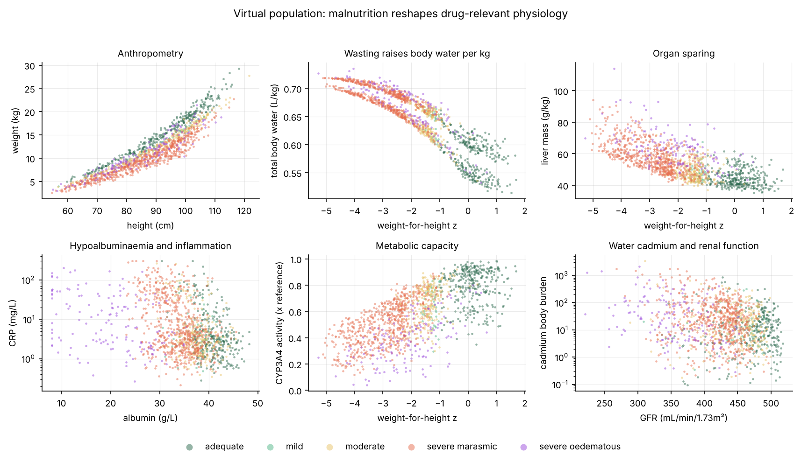
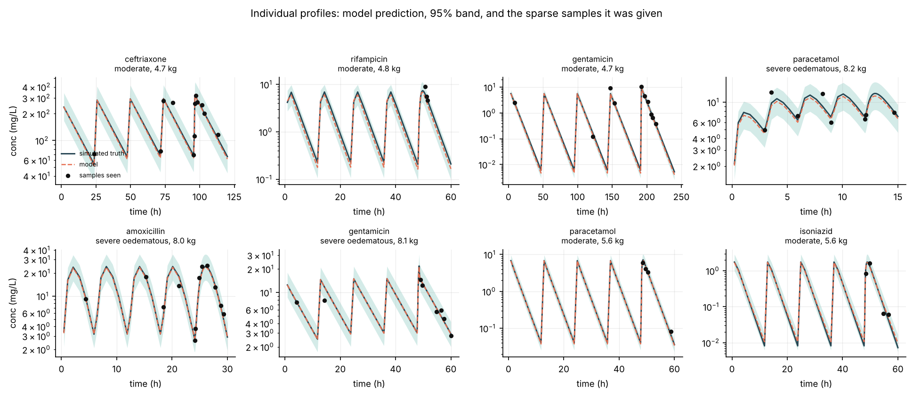

# Supporting Information

**Mechanism-constrained deep learning recovers individual pharmacokinetics
under undernutrition and water-toxicant co-exposure — an in silico study**

Pranav Manne

Every number reproduces from the accompanying code with
`bash scripts/run_all.sh`, followed by the sensitivity commands given in S6.


## S1. Accuracy by drug

Held-out patients, random patient split, 5,400 records, against the noise-free
simulated curve at all 50 time points.

| Drug | log-RMSE | Median fold error | Within twofold |
|---|---|---|---|
| Fluconazole | 0.031 | 1.019 | 100.0% |
| Gentamicin | 0.049 | 1.019 | 100.0% |
| Paracetamol | 0.066 | 1.039 | 100.0% |
| Ceftriaxone | 0.079 | 1.041 | 100.0% |
| Lumefantrine | 0.159 | 1.092 | 99.7% |
| Isoniazid | 0.229 | 1.080 | 98.1% |
| Albendazole | 0.248 | 1.105 | 97.6% |
| Amoxicillin | 0.277 | 1.083 | 96.9% |
| Rifampicin | 0.313 | 1.114 | 95.3% |

Accuracy is highest for drugs whose disposition is governed by few mechanisms
(fluconazole, gentamicin) and lowest for those where absorption and metabolism
both move under malnutrition (rifampicin, amoxicillin, albendazole).

## S2. Uncertainty calibration

| Nominal level | Total interval vs observations | Epistemic vs truth, raw | Epistemic vs truth, recalibrated |
|---|---|---|---|
| 50% | 49.4% | 20.3% | 54.0% |
| 80% | 79.4% | 36.6% | 78.3% |
| 90% | 89.3% | 45.0% | 86.0% |
| 95% | 94.2% | 51.5% | 90.5% |

Fitted variance-recalibration scale: **3.13**, estimated on the validation
split and applied unchanged to test.

## S3. Permutation importance, top ten

Each feature permuted within its observed marginal, holding all else fixed;
two repeats, held-out records. Laboratory values are permuted jointly with
their missingness mask.

| Rank | Feature | Block | Δ log-RMSE |
|---|---|---|---|
| 1 | body weight | anthropometry | 0.3893 |
| 2 | oedema grade | anthropometry | 0.2031 |
| 3 | sex | anthropometry | 0.1969 |
| 4 | water arsenic | toxicants | 0.1596 |
| 5 | serum albumin | labs | 0.1572 |
| 6 | weight-for-height percentage | anthropometry | 0.0895 |
| 7 | weight-for-height z-score | anthropometry | 0.0714 |
| 8 | water lead | toxicants | 0.0523 |
| 9 | body mass index | anthropometry | 0.0453 |
| 10 | C-reactive protein | labs | 0.0404 |

Rank 3 is analysed in S7.

## S4. Held-out-drug transfer

Trained without rifampicin and gentamicin; tested on those two only.

| Held-out drug | Median fold error | Within twofold |
|---|---|---|
| Gentamicin | 19.42 | 8.7% |
| Rifampicin | 4.77 | 27.2% |

## S5. Pharmacodynamic target audit

Targets as implemented, with sourcing status. The index scored for `auc_mic`
drugs is **free** AUC over the dosing interval divided by MIC.

| Drug | Index | MIC (mg/L) | Target | Toxicity metric | Toxic threshold (mg/L) | Source |
|---|---|---|---|---|---|---|
| Amoxicillin | fT>MIC | 4.0 | 0.50 | Cmax | 60 | Craig 1998 (class-level) |
| Ceftriaxone | fT>MIC | 1.0 | 0.60 | Cmax | 400 | Craig 1998 (class-level) |
| Gentamicin | Cmax/MIC | 1.0 | 8.0 | **Cmin** | **0.5** | Hollander et al. 2023 |
| Lumefantrine | day-7 trough | 0.28 | 0.28 | Cmax | 25 | WWARN 2015 (200–256 ng/mL) |
| Fluconazole | AUC/MIC | 2.0 | 110 | Cmax | 80 | EUCAST 2008 (fAUC/MIC ≥100) |
| Rifampicin | AUC/MIC | 0.25 | 38 | Cmax | 35 | **unsourced** |
| Isoniazid | AUC/MIC | 0.05 | 14 | Cmax | 12 | **unsourced** |
| Albendazole | AUC/MIC | 0.10 | 2.0 | Cmax | 8 | **unsourced** |
| Paracetamol | AUC/MIC | 5.0 | 20 | Cmax | 120 | **placeholder, not a PD claim** |

### Targets tested against a well-nourished reference child

Forty virtual children drawn from the adequate-nutrition stratum, dosed at the
label regimen, scored by the simulator. This isolates whether a target is
reachable *before* any malnutrition effect.

| Drug | Index reached | Implemented target | Attained? |
|---|---|---|---|
| Rifampicin | 24.1 | 38 | **no** |
| Amoxicillin | 0.29 | 0.50 | **no** |
| Isoniazid | 232 | 14 | yes, ~16× over |
| Fluconazole | 86.6 | 110 | marginal |
| Gentamicin | 16.5 | 8.0 | yes |
| Albendazole | 8.0 | 2.0 | yes |
| Ceftriaxone | 1.00 | 0.60 | yes |
| Lumefantrine | 3.08 | 0.28 | yes |

Rifampicin and amoxicillin do not reach their implemented targets in a
well-nourished child, so the low baseline attainment reported for them in the
main text is not attributable to undernutrition. Isoniazid's target is met by a
wide margin and published AUC0-24/MIC targets for isoniazid are 567 (murine)
and ~707 (in vitro), roughly fortyfold higher than the implemented value.

## S6. Target sensitivity analyses

### Gentamicin trough threshold

The only toxicity signal in the dosing experiment.

| Threshold | Source | Over-exposed, label | Over-exposed, model | Attainment |
|---|---|---|---|---|
| 2.0 mg/L | unsourced (previous implementation) | 0.0% | 0.0% | 100% → 100% |
| 1.0 mg/L | neonatal target | 2.5% | 0.0% | 100% → 100% |
| **0.5 mg/L** | **paediatric target, implemented** | **12.5%** | **0.0%** | 100% → 100% |

```
python scripts/clinical_impact.py --run runs/main_hybrid --n 120 \
    --drugs gentamicin --policy anchored
```
with `toxic_threshold` set to each value in `malnupk/drugs.py`. Outputs in
`outputs/ci_gent_*.json`.

### Amoxicillin fT>MIC target

| Target | Attainment, label | Attainment, model | Median dose |
|---|---|---|---|
| 50% (implemented) | 7.5% | 15.0% | 2.16× |
| 40% | 19.2% | 71.7% | 1.85× |

Output in `outputs/ci_amox_target40.json`.

## S7. The sex over-attribution diagnostic

Sex enters the simulator at one point only: the sex-specific constants of the
fat-free-mass relation, which propagate to total body water and hence to
distribution volume. Its causal magnitude is therefore directly measurable.

**Procedure.** Sample 400 virtual patients. For each, flip `male`, rebuild the
fat-free mass and body-water compartments that follow from it, and re-derive
the pharmacokinetic parameters for all nine drugs. Anthropometry (age, weight,
height, MUAC, oedema grade) is held fixed, so only the body-composition pathway
moves. The model's response is obtained by flipping the same input in the
held-out feature matrix and comparing predicted parameters.

| Parameter | Simulator (RMS log change) | Model (RMS log change) | Ratio |
|---|---|---|---|
| CL | 0.0000 | 0.0220 | model responds; simulator does not |
| V1 | 0.0422 | 0.1476 | 3.5× |
| Q | 0.0000 | 0.0196 | model responds; simulator does not |
| V2 | 0.0417 | 0.1983 | 4.8× |
| ka | 0.0000 | 0.0341 | model responds; simulator does not |
| F | 0.0000 | 0.0234 | model responds; simulator does not |
| fu | 0.0000 | 0.0307 | model responds; simulator does not |

Flipping sex changes fat-free mass by a median of 3.3% at identical weight,
height and oedema grade.

**Interpretation.** The model moves the distribution volumes three-and-a-half
to nearly five times more than the simulator does, and moves five parameters
the simulator does not move at all. The permutation importance of sex is
therefore a true statement about the model and a false one about the mechanism.

**Most likely cause.** Four other inputs — height-for-age, weight-for-height
and weight-for-age z-scores, and weight-for-height percentage — are computed
against sex-specific reference curves, so sex is partly recoverable from them.
With redundant inputs, a network can distribute a learned effect among them in
any proportion. The seven-parameter bottleneck constrains what the intermediate
quantities mean, not how the encoder arrives at them, and auxiliary supervision
on latent physiology did not prevent the over-attribution.

Reproduce with `python scripts/diagnose_sex.py`.

## S8. Dosing results in full

120 virtual patients disjoint from all training and validation data, 8 drugs,
960 decisions. Anchored policy. Both arms scored by the simulator.

### By drug

| Drug | Reached target | Exceeded toxicity | Median dose ratio | Interval changed |
|---|---|---|---|---|
| Rifampicin | 8.3% → 87.5% | 0.0% → 0.0% | 1.85× | 4% |
| Albendazole | 62.5% → 98.3% | 0.0% → 0.0% | 1.17× | 6% |
| Isoniazid | 74.2% → 99.2% | 0.0% → 0.0% | 1.17× | 0% |
| Amoxicillin | 7.5% → 15.0% | 0.0% → 0.0% | 2.16× | 0% |
| Gentamicin | 100% → 100% | 12.5% → 0.0% | 1.00× | 6% |
| Lumefantrine | 100% → 100% | 0.0% → 0.0% | 1.00× | 0% |
| Ceftriaxone | 100% → 100% | 0.0% → 0.0% | 1.00× | 0% |
| Fluconazole | 100% → 100% | 0.0% → 0.0% | 1.00× | 0% |

### By nutritional stratum

| Stratum | Reached target | Dose ratio, 10th–90th percentile |
|---|---|---|
| Adequate | 73.6% → 86.6% | 1.00–1.85× |
| Mild | 71.9% → 87.5% | 1.00–1.85× |
| Moderate | 71.0% → 87.0% | 1.00–1.85× |
| Severe, marasmic | 65.0% → 87.2% | 1.00–2.16× |
| Severe, oedematous | 69.1% → 90.8% | 1.00–4.00× |

### Policy comparison

| Policy | Reached target | Exceeded toxicity | Median dose |
|---|---|---|---|
| Label (weight band) | 69.1% | 1.6% | 1.00× |
| Anchored (default) | 87.5% | 0.0% | 1.00× |
| Minimum effective | 87.3% | 0.0% | 0.63× |

## S9. Claims without a verified source

Nine assertions in the Introduction or Methods of the main manuscript have no
verified primary source. They are reproduced here for convenience; the main
text carries the same list.

| Claim | Status |
|---|---|
| Visceral organ mass falls sub-proportionally to body weight (the 0.45 sparing exponent) | No measured source. |
| Extracellular water expands with reciprocal intracellular depletion | Total body water elevation is sourced; the compartment split is not. |
| Creatinine-based GFR is biased upward at low muscle mass | The paediatric equation is sourced; the bias is not. |
| EED specifics: villous blunting, raised gastric pH, bile-salt deficiency | EED in general is sourced; these three mechanisms are not. |
| AGP rise lowers unbound fraction of basic drugs | The acute-phase rise and basic-drug binding are sourced; the combined claim is an inference. |
| DMT1 up-regulation extends to lead and manganese, and to children | Sourced for cadmium in rats. |
| Arsenic methylation is methyl-donor limited under protein deficit | SAM dependence is sourced; nutritional limitation is not. |
| Cadmium nephrotoxicity reduces glomerular filtration | Tubular dysfunction is sourced at borderline significance; filtration was not measured. |
| PK/PD targets for rifampicin, isoniazid, albendazole; paracetamol placeholder | See S5. |

For five of these the general pharmacology is sourced and the
nutrition-dependent limb is not. That limb is the coupled nutrition–toxicant
axis, which is the distinctive claim of the simulator, and it currently rests
on mechanistic plausibility rather than on measurement.




**Figure S1 | The simulated population.** Anthropometry, body composition,
organ mass and derived physiology across the five nutritional strata.



**Figure S2 | Representative predicted and simulated concentration–time
profiles**, across drugs and nutritional strata, showing the sparse observed
samples the model actually received.
